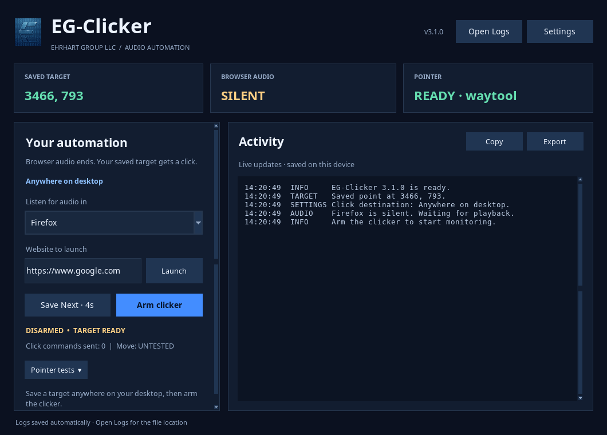

# EG-Clicker for Windows

**The modern EG desktop clicker, packaged for Windows 11 x64.**

[Download Windows Setup](https://github.com/jmebrohart-maker/EG-Clicker/releases/tag/windows-v3.1.0) ·
[Report an issue](https://github.com/jmebrohart-maker/EG-Clicker/issues/new/choose) ·
[Fedora edition](../README.md)



*The Windows edition uses this EG layout with Segoe UI and native Windows audio/input integration.*

[](https://github.com/jmebrohart-maker/EG-Clicker/actions/workflows/windows.yml)

## Install with one setup file

1. Download **EG-Clicker-Windows-Setup-3.1.0.exe** from the Windows release.
2. Close any older EG-Clicker window and double-click Setup.
3. Setup installs for your current user, creates Desktop/Start-menu shortcuts,
   registers an uninstaller and launches EG-Clicker.

Python, Tkinter and the audio libraries are bundled. No system Python, WinGet,
PowerShell execution-policy change or administrator access is required.

This initial Windows package is a preview for desktop testing. It is not code
signed; Windows may show an unknown-publisher/SmartScreen prompt. Verify that your
file came from this repository's release and matches `SHA256SUMS-Windows.txt`.
No Windows security feature is disabled by this installer.

A **Portable ZIP** is also available: extract the entire folder, then open
`EG-Clicker.exe`. Keep its `_internal` folder beside the executable.

## Use

Choose your browser, save the desired point with **Save Next · 4s**, then press
**Arm clicker**. The selected browser supplies the audio trigger. After its
session audio stops for two seconds, EG-Clicker clicks the saved desktop point.

Anywhere on desktop is the default. Settings → **Require the captured browser
window** enables optional checks for that same active, uncovered window. Capture
again after enabling it. Both modes verify pointer placement. Movement retries,
tolerance, settling delay, URL and browser selection persist between sessions.

Activity stays visible; use **Copy**, **Export** or **Open Logs** for diagnostics.
Chromium builds that name their process `chrome.exe` should use the Chrome
selector. Audio matching uses browser executable names. The selected browser's
own audio sessions are metered, rather than the shared
speaker output. Other applications do not count as that browser's audio.

The app runs at normal user privilege and cannot inject input into elevated
applications or the Windows secure desktop. It never elevates itself to bypass
that boundary. Multiple monitors and DPI-aware physical pointer coordinates are
supported; capture again after changing display layout.

## Installed files and uninstall

Application: `%LOCALAPPDATA%\Programs\Ehrhart Group\EG-Clicker`

Settings: `%APPDATA%\EG-Clicker\config.json`

Logs: `%LOCALAPPDATA%\EG-Clicker\logs`

Uninstall through **Windows Settings → Apps → Installed apps → EG-Clicker for
Windows**, or **Start → Ehrhart Group → EG-Clicker → Uninstall EG-Clicker**.
The native uninstaller removes its application files and shortcuts. Settings
and logs are preserved so an upgrade/reinstall does not lose your configuration.
To reset them, close the app and remove only the two EG-Clicker data folders
listed above.

Legacy source/venv installs are not silently deleted. Close their running window
before using the new edition. The new installer replaces the old desktop shortcut
and removes the old flat Start-menu shortcuts; its native files use the new
Ehrhart Group program folder.

## Build from source

On Windows x64 with Python 3.13 and NSIS 3 installed:

```powershell
py -3.13 -m venv windows/.venv
windows/.venv/Scripts/python -m pip install --only-binary=:all: --require-hashes -r windows/requirements-build.lock
# Activate the environment so build.ps1 uses that interpreter:
windows/.venv/Scripts/Activate.ps1
python -m unittest discover -s windows/tests -v
powershell -NoProfile -File windows/scripts/build.ps1
```

The build produces a self-contained setup executable, a portable ZIP and
checksums under `windows/dist`. Wheels, build directories and generated binaries
are not committed. Dependencies are version- and hash-locked for CPython 3.13
Windows x64. The installer is built on a Windows GitHub runner, not cross-compiled
from Linux.

A read-only frozen-runtime check is available:

```powershell
& "path\to\EG-Clicker.exe" --self-test --output "$env:TEMP\eg-self-test.json"
& "path\to\EG-Clicker.exe" --diagnose --output "$env:TEMP\eg-diagnostics.txt"
```

Self-test checks the bundled Python/Tk runtime, audio imports and Win32 structure
layout without moving or clicking the pointer. Tests simulate browser audio and
input; real Windows 11 browser/audio workflows still require user testing.

The uploaded 2.x Windows files were modernized into this isolated project. The
Fedora application and its published release are maintained separately in the
same repository. Both editions retain EG branding. Current source uses the
[EG-Clicker Free Use / No Modifications License](../LICENSE): free personal and
noncommercial use, free commercial use below 100 employees, and separate written
permission for commercial use at 100 or more employees or any modifications.
Settings changes and building unchanged source are allowed. The already-published
`windows-v3.1.0` preview retains its original MIT license; these new terms apply
prospectively. Third-party components keep their own licenses.
